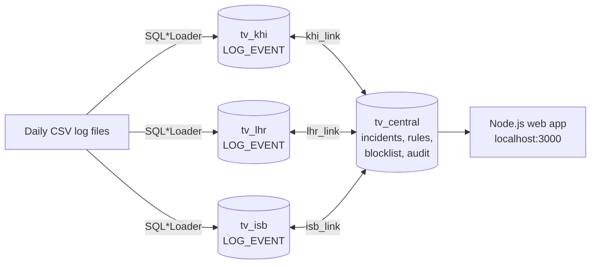

# ThreatVault

**A Security Log and Incident Database**, built on Oracle 21c XE with a Node.js web dashboard.

Database Administration and Management Lab (ITL 327), BS IT 7th Semester, Fall 2026, Bahria University Karachi.

| Member | Enrollment |
| --- | --- |
| Esha Ashfaq | 02-235232-002 |
| Maham Imran | 02-235232-030 |
| Mujtaba | 02-235232-048 |

---

## What it does

A small Security Operations Centre (SOC) has three offices: Karachi, Lahore and Islamabad. Every office produces security logs (logins, web requests, firewall blocks, malware alerts, phishing clicks). ThreatVault:

1. **Loads** the daily log files into each office's own database (SQL*Loader).
2. **Stores** the logs in daily partitions so searches stay fast.
3. **Detects** attacks (brute force, DDoS, malware, phishing) and opens incidents.
4. Lets analysts **assign, investigate, block and close** incidents from a web dashboard.
5. **Reports** attack trends with ROLLUP, CUBE and set operators.
6. **Audits** every change, so nobody can quietly delete log evidence.



## Course concepts covered

| Lab | Topic | Where |
| --- | --- | --- |
| 1 | Set operators | INTERSECT, MINUS, UNION reports: `sql/08_reports.sql`, Reports page |
| 2 | Fragmentation, allocation, replication | One schema per site, DB links, `ALL_LOG_EVENTS` view, rule and blocklist copies |
| 3, 4 | Extraction and loading | `sql/loader/log_event.ctl`, `scripts/load_logs.bat`, external table |
| 5 | Export and import | `scripts/export_logs.bat`, `scripts/import_logs.bat` (Data Pump) |
| 6 | Summarized data | ROLLUP, CUBE, GROUPING SETS |
| 7 | Partitioning, materialized views | Daily interval partitions, `MV_DAILY_ATTACKS` |
| 9 | Packages | `PKG_SOC` in `sql/05_package.sql` |
| 10 to 12 | Objects, methods, inheritance | `incident_t` (NOT INSTANTIABLE) with 4 subtypes, overloading, overriding, static method |
| 13 | Transactions | `close_incident` with SAVEPOINT and ROLLBACK, distributed `block_ip` |
| 14 | Auditing | Unified audit policy + audit triggers |

The web app also has a **Course Concepts** page with this mapping.

## Folder structure

```
threatvault/
  sql/            install.sql and numbered scripts (run in SQL*Plus)
    loader/       SQL*Loader control file
    extras/       partition, archive, external table and transaction demos
  scripts/        Windows .bat files: install, load, export, import
  tools/          log generator and Node.js loader
  data/           generated CSV files (not pushed to GitHub)
  web/            Node.js + Express dashboard (EJS pages)
```

---

## Quick setup (double click)

1. Make sure **Oracle** (21c XE, or 23ai / 26ai Free) and **Node.js** are installed. SETUP.bat finds the right database name (XEPDB1 or FREEPDB1) by itself.
2. Double click **`SETUP.bat`** and type your Oracle SYSTEM password when asked. It installs everything and loads the sample logs.
3. Double click **`START.bat`**. The website opens at http://localhost:3000 (login `admin` / `admin123`).

The manual steps below do the same thing one by one.

## Setup (Windows, about 15 minutes)

### 1. What you need

* **Oracle Database 21c XE** installed and running (default service `XEPDB1`, port 1521)
* **Node.js 18 or newer** ([nodejs.org](https://nodejs.org))
* SQL*Plus and SQL*Loader (both come with Oracle XE)

### 2. Settings

1. Create the folder `C:\threatvault_dump` (used by Data Pump and the external table).
2. Open `sql/config.sql` and `scripts/config.bat`. Put **your SYSTEM password** in both (`syspwd` and `SYS_PWD`). Keep the other values unless your setup is different.

### 3. Create the database

Double click `scripts\install_db.bat`, or in Command Prompt:

```bat
cd threatvault\sql
sqlplus system/YOUR_SYSTEM_PASSWORD@localhost:1521/XEPDB1 @install.sql
```

This creates 4 users (`tv_central`, `tv_khi`, `tv_lhr`, `tv_isb`), all tables, object types, the package, triggers, the materialized view, the audit policy and the seed data. Type `exit` when it finishes.

### 4. Install the web app and load logs

```bat
cd threatvault
npm install
copy .env.example .env
npm run generate
scripts\load_logs.bat
```

* `npm run generate` creates about 99,000 sample log rows for the last 14 days in `data/`.
* `scripts\load_logs.bat` loads them with **SQL*Loader**, then runs detection and refreshes the summary.
* If `sqlldr` is not found, use `npm run load` instead (same result, loads with Node.js).

Check that everything is connected:

```bat
npm run check
```

### 5. Start

```bat
npm start
```

Open **http://localhost:3000**

| Username | Password | Role |
| --- | --- | --- |
| admin | admin123 | Admin (can run detection, edit rules, add users) |
| esha | analyst123 | Analyst |
| maham | analyst123 | Analyst |
| mujtaba | analyst123 | Analyst |

---

## Demo plan for the presentation

1. **Dashboard:** KPIs and charts come from the materialized view.
2. **Logs:** pick one day. Explain partition pruning. Pick one site and show it reads `khi_logs`, a synonym for `log_event@khi_link` (fragmentation).
3. **Incidents:** open a brute force incident. Show `risk_score()` (overridden) and `risk_score(criticality)` (overloaded), the evidence rows, and the timeline.
4. **Transaction:** tick "simulate a failure" and close. The error appears and nothing changed (ROLLBACK). Close again normally: action saved, IP blocked at all sites, incident closed.
5. **Blocklist:** replication status shows the same count at central and every site.
6. **Reports:** INTERSECT (attackers at all three sites), MINUS, ROLLUP, CUBE, TREAT.
7. **Admin, Audit demo:** delete one log row, then open **Audit**: it shows up in the site trigger table and in `UNIFIED_AUDIT_TRAIL`.
8. **SQL*Plus:** run `sql/extras/11_partition_demo.sql` (as `tv_khi`) to show `EXPLAIN PLAN` with one partition, and `scripts\export_logs.bat` for Data Pump.

Useful SQL*Plus commands:

```sql
-- as tv_central
EXEC pkg_soc.sync_rules
EXEC pkg_soc.refresh_summary
SELECT pkg_soc.open_incident_count FROM dual;
@08_reports.sql
@extras/14_transaction_demo.sql
```

---

## Troubleshooting

| Problem | Fix |
| --- | --- |
| `ORA-12514` service XEPDB1 not registered | You have Oracle Free (23ai / 26ai): the name is `FREEPDB1`. Run SETUP.bat again, or put `localhost:1521/FREEPDB1` in `.env`, `sql/config.sql` and `scripts/config.bat`. |
| `ORA-12541` or `ORA-12514` | Oracle is not running, or the service name is different. Start the `OracleServiceXE` and `OracleOraDB21Home1TNSListener` services. Check `DB_CONNECT` in `.env`. |
| `ORA-01017` invalid username/password | The password in `.env` or `config.sql` does not match. |
| `sqlldr` is not recognized | Use `npm run load`, or add the Oracle `bin` folder to PATH. |
| Dashboard is empty | Click **Refresh now** on the Admin page (refreshes the materialized view). |
| No incidents | Admin page, **Run detection**. Rules look at the last 30 days, so regenerate logs if they are older (`npm run generate`, then reload). |
| Audit page section 3 is empty | Oracle may write unified audit records a bit later. As SYSTEM run `EXEC DBMS_AUDIT_MGMT.FLUSH_UNIFIED_AUDIT_TRAIL;` |
| Start over | `sqlplus system/PASSWORD@localhost:1521/XEPDB1 @sql/uninstall.sql`, then install again. |

## Push to GitHub

```bat
cd threatvault
git init
git add .
git commit -m "ThreatVault DBA project"
git branch -M main
git remote add origin https://github.com/YOUR_USERNAME/threatvault.git
git push -u origin main
```

`node_modules`, `.env` and the generated CSV files are ignored by `.gitignore`. Each member runs `npm install` and `npm run generate` after cloning.
